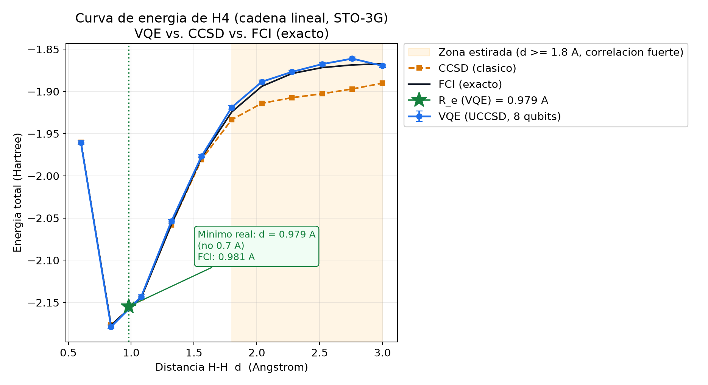

# Guion para la presentación — VQE para H₄

Este documento está pensado para que las 4 personas del equipo puedan presentar el proyecto
**sin necesitar formación previa en computación cuántica**. No es el notebook, no es código: es la
historia que contamos, con las analogías y los números reales para respaldarla. Dividimos el guion en
6 bloques — alcanza para repartir ~1-2 bloques por persona. Cada bloque tiene: qué decir, por qué,
y la analogía para no quedarse en el aire si alguien pregunta "¿pero esto qué significa en criollo?".

Antes de memorizar nada: lean una vez entero, en voz alta, los 6 bloques. El objetivo no es sonar
como que dominamos 10 años de química cuántica — es poder explicar con claridad **qué problema
resolvimos, cómo, y qué tan bien**, y no perder pie si alguien pregunta algo incómodo (para eso está
el bloque 6).

---

## Bloque 1 — El problema, en una frase

> "Tenemos 4 átomos de hidrógeno en fila. Los vamos separando de a poquito, como si estirásemos un
> resorte, y en cada posición calculamos cuánta energía tiene la molécula. Esa curva — energía en
> función de la distancia — nos dice todo lo importante: a qué distancia la molécula es más estable,
> y cuánta energía hace falta para romperla del todo."

**Por qué importa (más allá del hackathon):** esta curva de energía es el tipo de cálculo que hace
falta para entender reacciones químicas, diseñar materiales o remedios. El problema real es que para
moléculas más grandes que un puñado de átomos, calcularla exactamente en una computadora clásica es
intratable — la cantidad de información a guardar crece exponencialmente con el número de átomos. Las
computadoras cuánticas son, en teoría, una forma natural de representar ese tipo de información
porque un sistema cuántico (los qubits) tiene la misma "forma" exponencial que el problema que
queremos resolver.

**Por qué H₄ y no una molécula "importante":** porque H₄ es chico (8 qubits), así que lo podemos
simular en una computadora normal para después *comparar contra la respuesta exacta* y saber si
nuestro método funciona. Es el equivalente a probar una receta nueva con una porción chica antes de
cocinar para 50 personas.

---

## Bloque 2 — Por qué no alcanza con los métodos de siempre

Hay métodos clásicos (sin computadora cuántica) para estimar la energía de una molécula:

- **Hartree-Fock (HF):** la aproximación más simple y rápida. Analogía: calcular dónde se sienta cada
  invitado en una fiesta *asumiendo que nadie choca con nadie* — rápido, pero ignora que los
  electrones se repelen entre sí en tiempo real.
- **CCSD:** una mejora sobre HF que sí tiene en cuenta cómo los electrones se "acomodan" unos a otros,
  pero de forma aproximada. Funciona muy bien... **mientras los átomos estén cerca**.
- **FCI:** la respuesta exacta. Es la vara con la que medimos todo lo demás. El problema es que FCI
  solo es viable para moléculas chiquitas — para cualquier cosa interesante, es intratable.

**El quiebre:** cuando los átomos se separan mucho (lo que llamamos la **zona estirada**), CCSD
empieza a fallar y cada vez peor. Analogía: es como estirar una banda elástica atada a dos imanes —
mientras están cerca, un modelo simple describe bien la fuerza; muy separados, el comportamiento se
vuelve "raro" (en química se llama **correlación fuerte**) y los métodos baratos empiezan a adivinar
mal. Ahí es exactamente donde tiene sentido probar un método distinto — el desafío que nos dieron pide
textualmente ganarle a CCSD en esa zona.

---

## Bloque 3 — Qué es VQE, sin fórmulas

**VQE (Variational Quantum Eigensolver)** es un algoritmo híbrido: una parte corre en la computadora
cuántica, otra en una computadora normal, y se van turnando.

Analogía completa: estás en un valle con mucha niebla y querés encontrar el punto más bajo, pero no
podés ver el paisaje entero — solo podés parado en un punto, preguntar "¿qué tan alto estoy?" y dar un
paso. VQE hace exactamente eso:

1. Prepara un estado cuántico (un circuito) que depende de un puñado de "perillas" (parámetros).
2. Mide la energía de ese estado.
3. Una computadora clásica mira esa energía y decide cómo mover las perillas para bajarla.
4. Se repite hasta que no se puede bajar más.

Un dato que ayuda a que esto no suene mágico: existe una garantía matemática (el **principio
variacional**) de que el número que devuelve VQE *nunca* es menor que la energía real — solo puede
ser igual o estar por arriba. Eso es lo que nos permite, más adelante, decir "si un método da un
número más bajo que otro, ese está más cerca de la verdad", sin hacer trampa.

**Las "perillas" concretas — el ansatz UCCSD:** en vez de un circuito genérico, usamos un circuito
que arranca literalmente desde la solución de Hartree-Fock (la fiesta "sin choques" del bloque 2) y
le aplica ajustes que un químico reconocería (mover de a uno o de a dos electrones entre orbitales).
Probamos también un circuito genérico sin ninguna química incorporada, y se quedó pegado cerca de la
energía de Hartree-Fock — no encontraba cómo mejorar. El circuito "con química adentro" sí lo logra.
Esto es un hallazgo real del proyecto, no un detalle menor: la estructura del circuito importa tanto
como el algoritmo.

---

## Bloque 4 — Qué hicimos, paso a paso (la versión corta)

1. Para cada una de las 11 distancias (de 0,6 a 3,0 Å), calculamos con PySCF las referencias
   clásicas: Hartree-Fock, CCSD y FCI (la exacta, nuestra vara de medir).
2. Convertimos el problema de electrones a un problema de qubits con una técnica estándar
   (**Jordan-Wigner**): cada qubit representa si un "asiento" de electrón está ocupado o vacío. Con
   4 átomos de H en esta base (STO-3G), necesitamos **8 qubits**.
3. Armamos el circuito UCCSD descripto arriba (26 perillas/parámetros) y lo **transpilamos una sola
   vez** antes de optimizar — un detalle técnico que resultó ser el principal factor de velocidad
   (si no se hace, Qiskit reconstruye el circuito en cada paso del optimizador, ~10-15x más lento).
4. Buscamos las perillas óptimas. Acá la consigna del desafío permite algo clave: *buscar los
   parámetros sin ruido* (en una simulación exacta, más rápida), siempre y cuando **la energía que
   reportamos al final venga de medir el circuito con shots** — como se mediría en una computadora
   cuántica real. Lo cumplimos: usamos una simulación exacta solo para encontrar las perillas, y el
   número final sale de `EstimatorV2` de `qiskit_aer` con una cantidad fija de mediciones (shots).
5. Para no repetir una búsqueda a ciegas en cada una de las 11 distancias, usamos dos atajos:
   arrancar el primer punto con una semilla basada en CCSD (en vez de al azar), y para el resto,
   heredar las perillas óptimas del punto anterior ("warm start") — porque moléculas con geometrías
   parecidas tienen soluciones parecidas.

---

## Bloque 5 — Qué encontramos (los números reales)

*(Completar/confirmar el tiempo de ejecución final antes de presentar — está en ajuste; ver nota en
`docs/bitacora.md`.)*

**Ojo con un error fácil de cometer al mirar el gráfico a simple vista:** el mínimo de energía (la
distancia de equilibrio, donde la molécula es más estable) **no está en 0,7 Å** — ese valor queda en
la mitad de la bajada empinada, todavía lejos del piso de la curva. El mínimo real está marcado con la
estrella verde: **d ≈ 0,979 Å** (el ajuste exacto con FCI da 0,981 Å, prácticamente lo mismo). El
punto muestreado más bajo de los 11 que calculamos es d=0,84 Å; el 0,979 Å es el mínimo de la curva
*suave* que se ajusta a todos los puntos, que cae justo entre d=0,84 y d=1,08 Å. Convenga revisar este
gráfico antes de decir un número en voz alta frente al jurado.

- **Le ganamos a CCSD en los 6 de 6 puntos de la zona estirada** (d = 1,8 a 3,0 Å). El margen es
  angosto justo en el borde (d=1,8 Å: nuestro resultado quedó a 5,4 mHa de la respuesta exacta, contra
  9,1 mHa de CCSD) y se abre mucho más allá — en algunos puntos CCSD se equivoca por **30 mHa**
  mientras nosotros seguimos entre 2 y 7,5 mHa de la respuesta exacta.
- **Distancia de equilibrio (R_e):** nos dio 0,9793 Å contra 0,9811 Å de la respuesta exacta —
  una diferencia de menos de 2 milésimas de Å.
- **Energía de disociación (D_e)** — cuánta energía hace falta para separar del todo la molécula:
  285,2 mHa contra 288,5 mHa exactos — una diferencia de ~3 mHa.
- **Lo que no logramos:** la "precisión química" (menos de 1,6 mHa de error) es una meta extra del
  desafío, no obligatoria, y no la alcanzamos en ningún punto de la zona estirada. Es información
  honesta, no un fracaso del proyecto — cumplimos lo pedido, no el bonus más difícil.

**Cómo armamos el argumento de confiabilidad** (porque en una situación real no tendríamos la
respuesta exacta para comparar, como sí tenemos acá): el principio variacional (bloque 3) y un
chequeo de **varianza de la energía** — si el circuito preparase exactamente la energía más baja
posible, esa varianza sería cero; cuanto más baja, más confiamos en el resultado.

---

## Bloque 6 — Preguntas que seguro nos hacen (y cómo contestarlas)

**¿Esto corrió en una computadora cuántica real?**
No. Corrió en un simulador (`qiskit_aer`, que corre en una computadora clásica normal) que imita el
comportamiento de mediciones con shots. Es exactamente lo que pide el desafío: la energía final tiene
que salir de *medir* un circuito con una cantidad fija de mediciones (shots), no de leer el estado
interno del simulador como si fuera magia — así se comportaría igual en hardware real. Lo que
*no* simulamos es el ruido de un chip físico real (errores de las compuertas, decoherencia): eso
queda como trabajo futuro, no es parte de lo que hicimos.

**¿Cumplimos la consigna de punta a punta?**
Sí, en lo que pide como obligatorio: al menos 10 distancias con barra de error (tenemos 11), R_e y
D_e, y ganarle a CCSD en la zona estirada (6 de 6 puntos). No alcanzamos la meta extra de precisión
química, que el propio desafío marca como opcional. Un punto que seguimos cerrando antes de entregar:
el tiempo de ejecución — ver bloque 5.

**¿Por qué usamos UCCSD y no un circuito más simple?**
Porque lo probamos: un circuito genérico (sin química incorporada) se quedó pegado cerca de la energía
de Hartree-Fock, sin mejorar. UCCSD, que arranca de Hartree-Fock y aplica ajustes físicamente
sensatos, sí convergió cerca de la respuesta exacta. Es una decisión basada en evidencia, no en moda.

**¿Nos queda algo más para sumar puntos?**
Sí, varias cosas quedaron identificadas pero no implementadas (están en `docs/bitacora.md`): aplicar
un modelo de ruido realista + técnicas de mitigación de errores, reducir el problema a 6 qubits con
otro mapeo (parity), comparar formalmente UCCSD contra un ansatz genérico con más presupuesto, o
probar SQD (el algoritmo alternativo que la consigna permite como extra).

**¿No sería más rápido correr esto en una computadora cuántica real?**
No — sería mucho **más lento**, y conviene tenerlo claro antes de que lo pregunten. Nuestro
Hamiltoniano tiene 185 términos de Pauli, agrupados en 46 grupos que se pueden medir juntos. La
búsqueda de parámetros hace del orden de **decenas de miles de evaluaciones de energía**; en hardware
real, cada evaluación son 46 circuitos distintos, no uno — así que reemplazar toda la optimización por
hardware real tomaría **entre 8 y 32 días** en el escenario más optimista, no minutos. El cuello de
botella no es la física del qubit (eso tarda microsegundos): es cuántas veces hay que preguntarle algo
a la máquina. Por eso la estrategia que exige la propia consigna (buscar los parámetros sin ruido, y
medir el resultado final con shots) no es un atajo cualquiera — es, a este tamaño de problema (8
qubits), la única forma práctica de hacerlo. Si solo lleváramos a hardware real la medición final (ya
con los parámetros encontrados), son ~500 circuitos: unos 4 a 17 minutos de ejecución, más la cola de
turno de la máquina real.

**¿Qué fue lo más difícil?**
Doble respuesta honesta: (1) que el circuito "ingenuo" no convergía — hubo que usar uno con química
adentro; (2) que al principio la búsqueda de parámetros era carísima en tiempo, por un detalle técnico
de cómo Qiskit reconstruye circuitos — una vez identificado, se arregló y hubo que seguir afinándolo
para que el entregable final sea práctico de correr.
